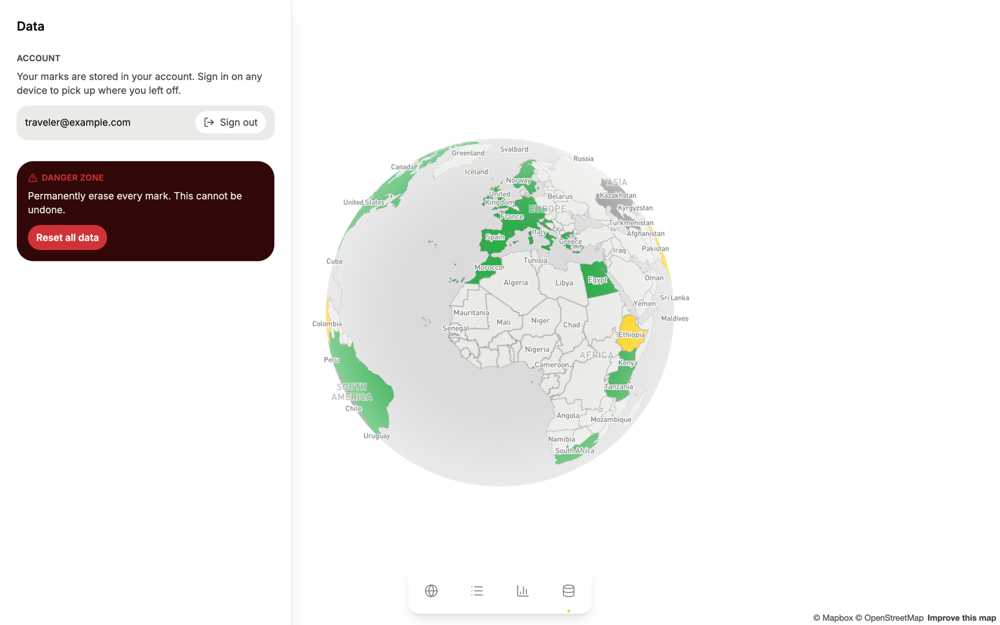

# Traviz

Mark the countries you've visited, want to visit, or aren't interested in, on an interactive globe. Your marks sync to your account, so they follow you across devices.


## Features

- **Interactive globe.** Spin and zoom the Mapbox globe, then click or tap a country to mark it. The globe keeps spinning until you interact with it.
- **Three states per country.** Visited, Want to go, and Not interested. Select the active state again, or use the clear button, to remove a mark.
- **Searchable list.** Every country grouped by continent, with search and filters by state. Territories are labeled.
- **Stats.** Progress toward the 195 countries in the headline count, with totals per state and a breakdown by continent.
- **Passwordless sign-in.** Enter your email and open the magic link. No passwords.
- **Synced to your account.** Every change is saved to a Turso (libSQL) database.
- **Works on phones.** Countries are marked from a bottom sheet, and navigation sits in a floating dock.

## Screenshots

<table>
  <tr>
    <td width="50%"></td>
    <td width="50%"></td>
  </tr>
  <tr>
    <td width="50%"></td>
    <td width="50%"></td>
  </tr>
</table>

<p align="center">
  
  
  
</p>

Screenshots show a demo account with sample marks, captured from a local production build.

## Getting started

### Prerequisites

- Node.js 20.9 or later (required by Next.js 16)
- pnpm 11, the version pinned in `package.json`. pnpm 10 can't read the lockfile.
- A Mapbox public access token
- A Turso database
- A Resend API key, plus a sender address on a domain you've verified

### Install

```bash
pnpm install
```

### Configure environment variables

Create a `.env.local` file in the project root:

```env
NEXT_PUBLIC_MAPBOX_TOKEN=pk.your_mapbox_public_token
TURSO_DATABASE_URL=libsql://your-database.turso.io
TURSO_AUTH_TOKEN=your_turso_auth_token
BETTER_AUTH_SECRET=your_random_secret
RESEND_API_KEY=re_your_resend_api_key
RESEND_FROM_EMAIL=Traviz <noreply@your-domain.com>
```

| Variable                   | Purpose                                                                                                            |
| -------------------------- | ------------------------------------------------------------------------------------------------------------------ |
| `NEXT_PUBLIC_MAPBOX_TOKEN` | Public Mapbox token that renders the globe. Restrict it to your domains in the Mapbox dashboard before going live. |
| `TURSO_DATABASE_URL`       | libSQL URL of the database that stores accounts, sessions, and marks.                                              |
| `TURSO_AUTH_TOKEN`         | Auth token for that database.                                                                                      |
| `BETTER_AUTH_SECRET`       | Secret that signs sessions. Generate one with `openssl rand -hex 32`.                                              |
| `RESEND_API_KEY`           | Resend API key used to send sign-in emails.                                                                        |
| `RESEND_FROM_EMAIL`        | Sender for sign-in emails. Sign-in fails without it.                                                               |

### Set up the database

```bash
pnpm db:migrate
```

This creates the better-auth tables and the `marks` table, which holds one row per user and country.

### Run locally

```bash
pnpm dev
```

Open http://localhost:3000, enter your email, and open the link in the sign-in email.

## Scripts

| Command              | What it does                                                            |
| -------------------- | ----------------------------------------------------------------------- |
| `pnpm dev`           | Start the Next.js dev server                                            |
| `pnpm build`         | Build for production                                                    |
| `pnpm start`         | Serve the production build                                              |
| `pnpm db:migrate`    | Create the auth tables and the `marks` table                            |
| `pnpm gen:countries` | Regenerate `src/data/countries.json` from the `world-countries` package |
| `pnpm lint`          | Lint with Oxlint                                                        |
| `pnpm format`        | Format with Oxfmt                                                       |
| `pnpm typecheck`     | Type-check with `tsc --noEmit`                                          |

## Country data

`src/data/countries.json` has 250 entries generated from the `world-countries` package. 195 of them count toward the headline total. The other 55 are territories and dependencies: they appear on the map and in the list, but they aren't counted. The generated file is committed, so only run `pnpm gen:countries` after you update that dependency.

## Project structure

```text
.
├── docs/    Engineering guidelines and screenshots
├── scripts/ Database migration and country generation
└── src/
    ├── app/             Routes: / (globe), /list, /stats, /data, and the auth API
    ├── components/      Shell, globe, list, stats, data, and sign-in components
    ├── features/marks/  Server Actions and services that save and load marks
    ├── lib/             Shared helpers, plus server-only auth, database, and email code
    ├── store/           Zustand store for marks: updates instantly, then syncs
    └── data/            Generated country list
```

## Deployment

- The project is deployed on Vercel. Any host that runs Next.js works too.
- Set the same environment variables on your host.
- `allowedHosts` in `src/lib/server/auth.ts` lists the hosts that auth trusts when it builds sign-in links: `localhost:3000`, `*.vercel.app`, and one production domain. Add your own domain there.
- Use a sender address on a domain you've verified in Resend.

## Contributing

Read [AGENTS.md](AGENTS.md) before contributing; it covers the project's conventions. Form rules are in [docs/FORM_HANDLING.md](docs/FORM_HANDLING.md), and the component and Server Action guidelines are in [docs/ARCHITECTURE.md](docs/ARCHITECTURE.md).

## License

MIT. See [LICENSE](LICENSE).
