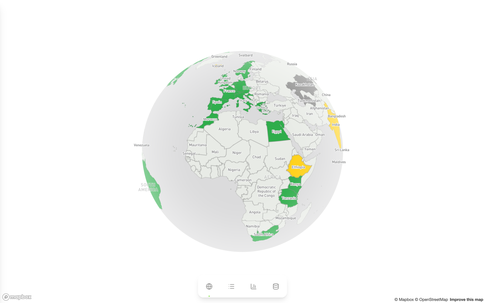
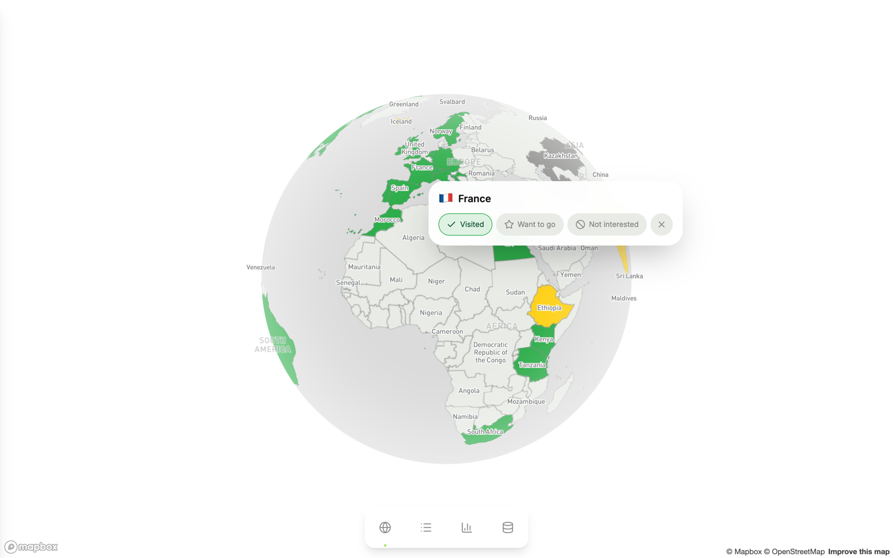
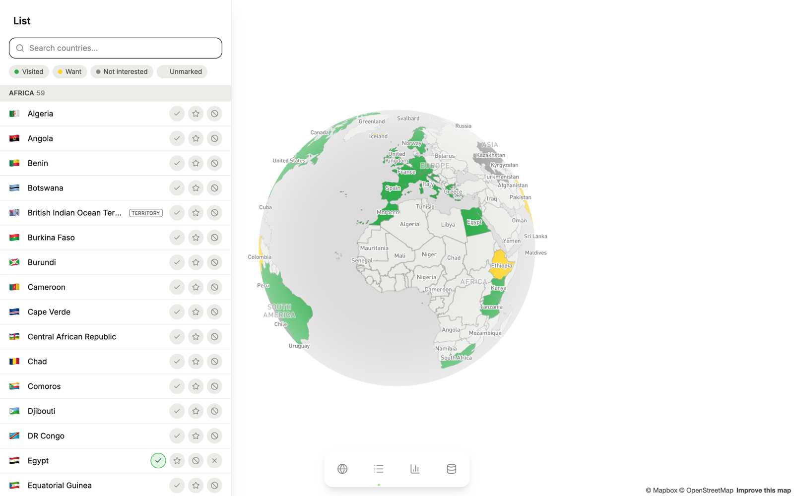
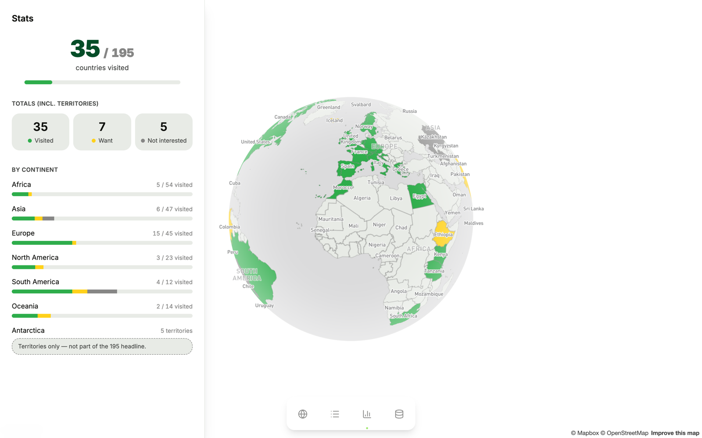
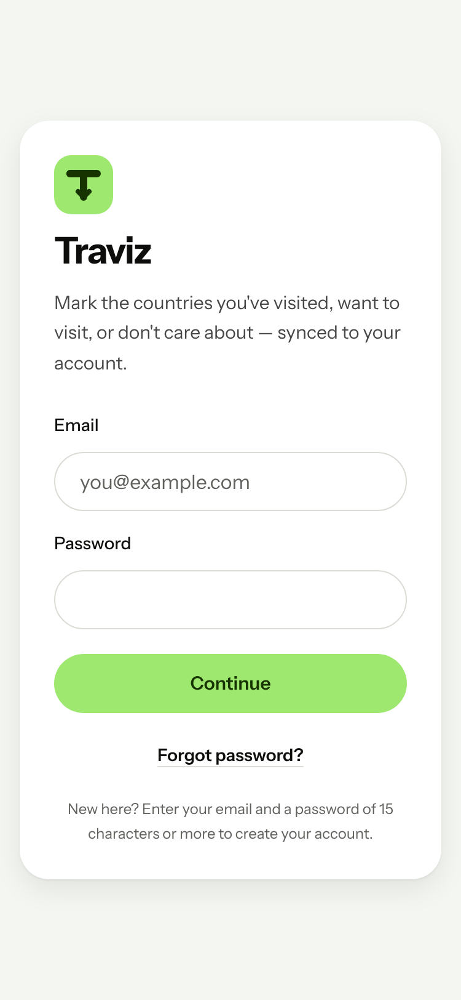
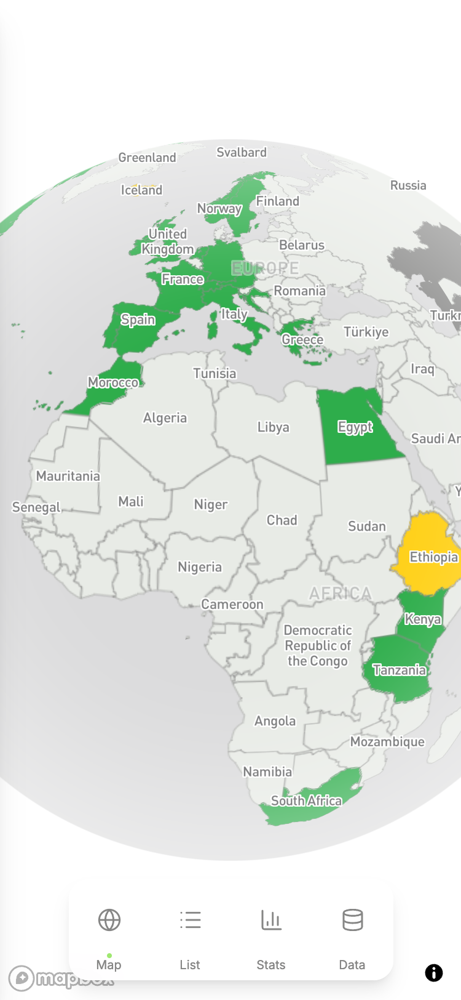
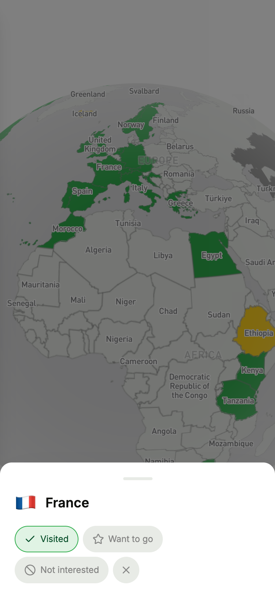

# Traviz

Mark the countries you've visited, want to visit, or aren't interested in, on an interactive globe. Your marks sync to your account, so they follow you across devices.



## Features

- **Interactive globe.** Spin and zoom the globe, then click or tap a country to mark it. The globe keeps spinning until you interact with it.
- **Three states per country.** Visited, Want to go, and Not interested. Select the active state again, or use the clear button, to remove a mark.
- **Searchable list.** Every country grouped by continent, with search and filters by state. Territories are labeled.
- **Stats.** Progress toward all 250 places, countries and territories, minus the ones marked not interested, with totals per state and a breakdown by continent.
- **Landing page.** Signed-out visitors land on `/welcome`, where all 195 countries are listed and can be marked on the spot, without saving, before signing in. It is prerendered, and its script is a few kilobytes of hand-written TypeScript.
- **Passwordless sign-in.** Enter your email and open the magic link. No passwords.
- **Synced to your account.** Every change is saved to a Turso (libSQL) database.
- **Works on phones.** Countries are marked from a bottom sheet, and a tab bar at the bottom holds the navigation.

## Stack

- [Astro 7](https://astro.build) with `output: "server"`: every page is rendered on the server with the user's marks in the HTML. There is no client framework. The browser code is hand-written TypeScript that Astro bundles, and the CSS is Tailwind 4, inlined into each page.
- [Clerk](https://clerk.com) for email link sign-in, through `@clerk/backend` on the server and clerk-js, loaded after the page, in the browser.
- [Turso](https://turso.tech) (libSQL) for the marks.
- A Canvas 2D globe drawn with `d3-geo`.
- Bun for packages, scripts and tests. oxlint, oxfmt, fallow and `astro check` are the gates.

## Screenshots

<table>
  <tr>
    <td width="50%"></td>
    <td width="50%"></td>
  </tr>
  <tr>
    <td colspan="2" align="center"></td>
  </tr>
</table>

<p align="center">
  
  
  
</p>

Screenshots show a demo account with sample marks, captured from a local production build.

## Getting started

### Quick setup for local development

```bash
bun install
bun run setup
bun run dev
```

`bun run setup` fills in `.env.local` for this worktree and keeps any value already there. It does the following:

- Writes the Clerk development keys as `PUBLIC_CLERK_PUBLISHABLE_KEY` and `CLERK_SECRET_KEY`, pulled with the `clerk` CLI unless `.env.local` already has them. It refuses to write a `pk_live_` or `sk_live_` key.
- Sets `TURSO_DATABASE_URL=file:.data/dev.db` and runs `bun run db:migrate`. Marks live in `.data/dev.db` inside each worktree, so no worktree writes a shared database. Setup refuses to run when `.env.local` or the process environment (shell or `.env`) names a remote database, a database file outside this worktree's `.data/` or a live Clerk key.
- Creates the Clerk development user `agent+clerk_test@example.com` if it does not exist yet, with the `clerk` CLI, or with Clerk's Backend API and the development secret key when the CLI is not installed.

`.env.example` lists the same variables.

To get a signed-in session without opening an email, run `bun run sign-in-token`. It prints a sign-in token for the development user that lasts 10 minutes. Open `/sign-in`, then run this in the browser console with the token as `ticket`, after `window.Clerk.loaded` is true:

```js
const signIn = await window.Clerk.client.signIn.create({ strategy: "ticket", ticket });
await window.Clerk.setActive({ session: signIn.createdSessionId });
```

The steps below set up the app by hand, for production or for a remote database.

### Prerequisites

- Node.js 24, the version CI and the Vercel function use. Astro 7 needs 22.23.4 or later
- Bun 1.4.3, the version CI pins. Bun does not check the `devEngines` version, so another version installs without a warning
- A Turso database
- A Clerk application set up for email link sign-in only

### Install

```bash
bun install
```

### Configure environment variables

Create a `.env.local` file in the project root:

```env
PUBLIC_CLERK_PUBLISHABLE_KEY=pk_test_your_clerk_publishable_key
CLERK_SECRET_KEY=sk_test_your_clerk_secret_key
TURSO_DATABASE_URL=libsql://your-database.turso.io
TURSO_AUTH_TOKEN=your_turso_auth_token
```

| Variable                       | Purpose                                                                                                         |
| ------------------------------ | --------------------------------------------------------------------------------------------------------------- |
| `PUBLIC_CLERK_PUBLISHABLE_KEY` | Public Clerk key. The build puts it in the browser code, and the server reads it to verify sessions.            |
| `CLERK_SECRET_KEY`             | Secret Clerk key used on the server to verify sessions. Never expose it to the client.                          |
| `TURSO_DATABASE_URL`           | libSQL URL of the database that stores marks.                                                                   |
| `TURSO_AUTH_TOKEN`             | Auth token for that database. Not needed for a `file:` URL.                                                     |
| `CLERK_AUTHORIZED_PARTIES`     | Optional. Comma-separated origins, such as `https://traviz.example`, whose session tokens the server accepts.   |
| `TRAVIZ_FIXED_USER_ID`         | Local runs only: signs every request in as this user without Clerk. Refused unless the database URL is `file:`. |
| `TRAVIZ_ADAPTER`               | Build time only: `node` builds a standalone Node server into `dist` instead of the Vercel output.               |

Both Clerk keys are on the API Keys page of your Clerk dashboard. `PUBLIC_CLERK_PUBLISHABLE_KEY` must be set when the app is built, not only when it runs.

The Clerk instance must use email link (magic link) sign-in only: no password or social providers.

### Set up the database

```bash
bun run db:migrate
```

This creates the `marks` table, which holds one row per user and country.

### Run locally

```bash
bun run dev
```

Open http://localhost:4321, enter your email, and open the link in the sign-in email.

## Scripts

| Command                 | What it does                                                                                                                          |
| ----------------------- | ------------------------------------------------------------------------------------------------------------------------------------- |
| `bun run dev`           | Start the Astro dev server                                                                                                            |
| `bun run build`         | Build for production with the Vercel adapter, into `.vercel/output`                                                                   |
| `bun run build:node`    | Build a standalone Node server into `dist`                                                                                            |
| `bun run start`         | Serve the Node build. `HOST` and `PORT` set where it listens                                                                          |
| `bun run setup`         | Fill in `.env.local` with development values, migrate `.data/dev.db` and create the development user                                  |
| `bun run sign-in-token` | Print a sign-in token for the development user                                                                                        |
| `bun run perf`          | A/B a production build of HEAD against `--baseline <ref>` (default `main`) in a throttled Chrome                                      |
| `bun run db:migrate`    | Create the `marks` table                                                                                                              |
| `bun run gen:countries` | Regenerate `src/features/countries/countries.generated.ts` from the `world-countries` package. `--check` fails when it is out of date |
| `bun run lint`          | Lint with Oxlint                                                                                                                      |
| `bun run format`        | Format with Oxfmt                                                                                                                     |
| `bun run typecheck`     | Type-check with `astro check` and `tsc --noEmit`                                                                                      |
| `bun run check:docs`    | Check that the docs name only paths and scripts that exist                                                                            |
| `bun run test`          | Run the bun tests under `src`                                                                                                         |
| `bun run test:rules`    | Run the lint rule tests in `tools/oxlint` with Node 24                                                                                |
| `bun run check:bundle`  | Check each page's JS, HTML and preloads in the last Node build against `bundle-budget.json`                                           |
| `bun run fallow`        | Report dead code, duplication and complexity                                                                                          |
| `bun run check`         | Run CI's checks, except fallow, with both builds                                                                                      |

`bun run perf` refuses a dirty tree, a `bun.lock` that differs from the baseline (unless `--allow-lockfile-diff`, for a change that adds or removes dependencies), a bun other than the `devEngines` pin, a database outside `.data/`, fewer than 5 runs, and a second run anywhere on the machine (`~/.local/state/traviz/perf.lock`). AGENTS.md describes the method and how to read the report.

## Country data

`src/features/countries/countries.generated.ts` has 250 entries generated from the `world-countries` package. Each entry has a `kind`. The 195 `sovereign` entries count toward the headline total. The 55 `territory` entries appear on the map and in the list, but they aren't counted. Each entry also has the `center` the globe flies to and a `hasGlobeLabel` flag for its label.

The globe draws the country outlines in `src/features/globe/country-topology.generated.ts`. They come from the Natural Earth 50m topology in the `world-atlas` package, keyed by the same codes, simplified, quantized and packed into text of about 36 KB gzipped. Gibraltar, Tokelau, Tuvalu, Bouvet Island and the US Minor Outlying Islands are too small for that data, so they have no outline, and you mark them from the list or the search.

`bun run gen:countries` writes both files. They are committed, so only run it after you update `world-countries` or `world-atlas`. `bun run check` runs `bun run gen:countries --check`, which fails when a committed file differs from a fresh run.

## Project structure

```text
.
├── astro.config.ts  Adapter choice, inlined CSS, and the plugin that inlines the app, sign-in and account menu scripts
├── paths.ts         One function per route, and the ROUTES table the request gate reads
├── docs/            Screenshots for this README
├── scripts/         Local setup, sign-in tokens, database migration, country generation, and the docs, gate and bundle checks
└── src/
    ├── pages/           One thin file per route: the pages, the view fragments and the API routes
    ├── middleware.ts    Authenticates each request and gates it by its ROUTES row
    ├── features/app-shell/ Layout of the signed-in pages, top bar, tab bar, and the view router that switches tabs in one document
    ├── features/auth/   Session reading on the server, email link sign-in, the account button, and the clerk-js loader
    ├── features/countries/ Generated country dataset and search
    ├── features/country-list/ The list view, with its search, status and continent filters
    ├── features/landing/ The landing page's components, styles and client code
    ├── features/globe/  Canvas globe engine and its generated outlines, the globe view, and the selected-country store
    ├── features/marks/  Marks reducer, owner and store, the wire format, and the handlers and services that save and load marks
    ├── features/stats/  The stats view and its model
    ├── features/theme/  Theme choice and the script that applies it before the first paint
    └── shared/          Store, icons, theme tokens, page head, server-only database and env code, and test helpers
```

## Deployment

The project is deployed on Vercel with the `@astrojs/vercel` adapter. `vercel.json` sets the framework preset, the install command and the build command, so a new Vercel project needs these settings only:

- **Framework preset:** Astro. **Build command:** `bun run build`. **Install command:** `bun install --frozen-lockfile`. **Output directory:** leave empty. The adapter writes `.vercel/output` itself.
- **Node.js version:** 24.x. `engines.node` in `package.json` asks for it, and the server function runs on the Node version of the build.
- **Environment variables**, for Production and Preview: `PUBLIC_CLERK_PUBLISHABLE_KEY`, `CLERK_SECRET_KEY`, `TURSO_DATABASE_URL` and `TURSO_AUTH_TOKEN`. `PUBLIC_CLERK_PUBLISHABLE_KEY` must be available to the build. Never set `TRAVIZ_FIXED_USER_ID` or `TRAVIZ_ADAPTER` there. `CLERK_AUTHORIZED_PARTIES` is optional and unset by default: set it to the site's origins to make the server refuse a Clerk session token that was issued for another origin.
- Add your production domain to the Clerk instance in the Clerk dashboard.

One Node function renders every page, fragment and API route, and streams its response. `/welcome`, the files in `public/` and the hashed files under `/_astro` are static and never reach the function.

Any host that runs Node works too: `bun run build:node`, then `bun run start` with the same environment variables. `scripts/serve-node.ts` gzips the pages and the static files itself, so it needs no proxy in front for that.

## Contributing

Read [AGENTS.md](AGENTS.md) before contributing. It explains how the app works, lists the project's rules, and names the check that enforces each one.

## License

MIT. See [LICENSE](LICENSE).
