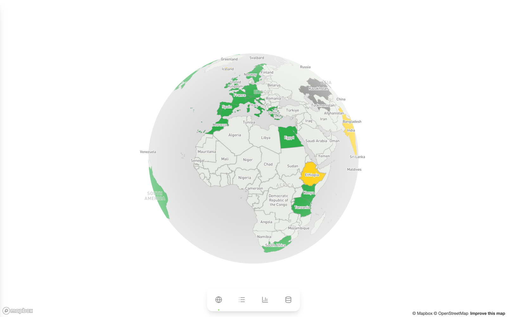
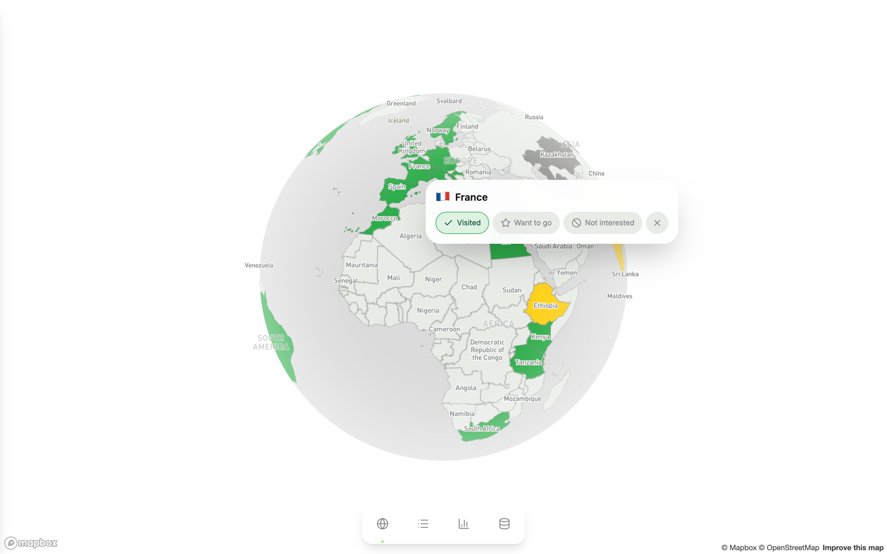
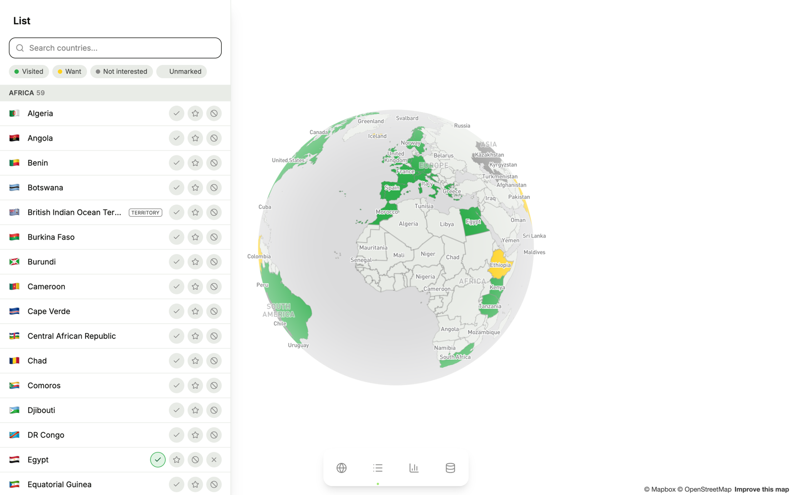
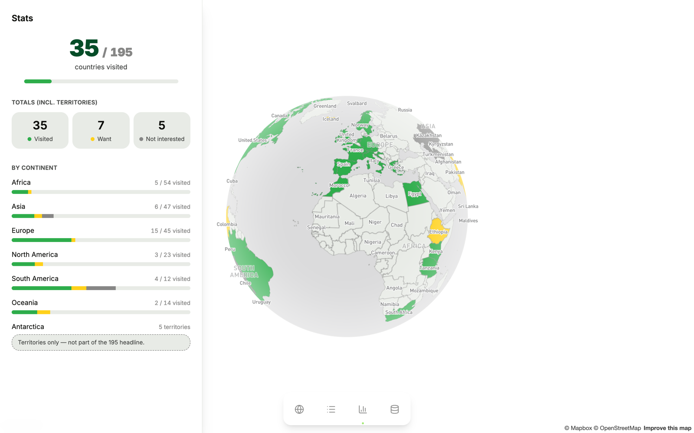
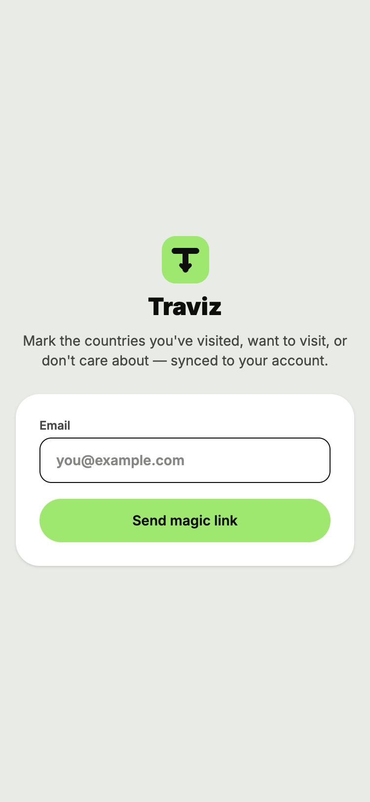
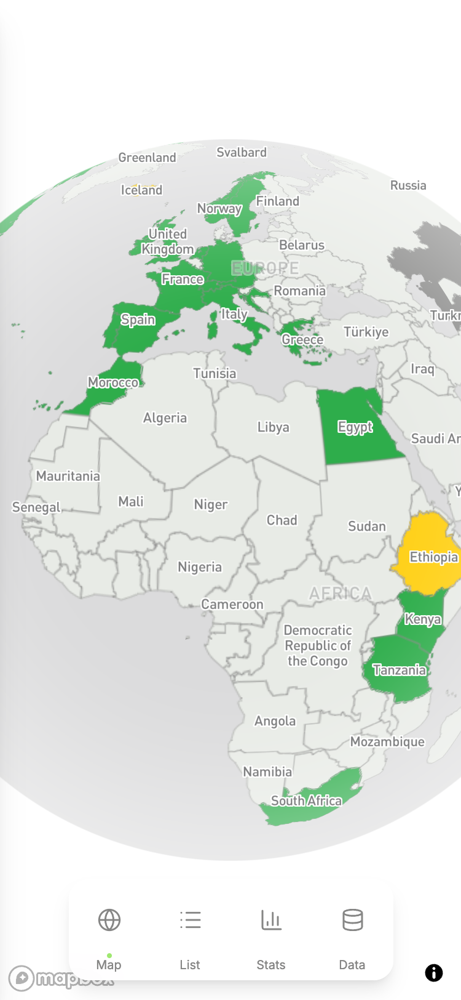
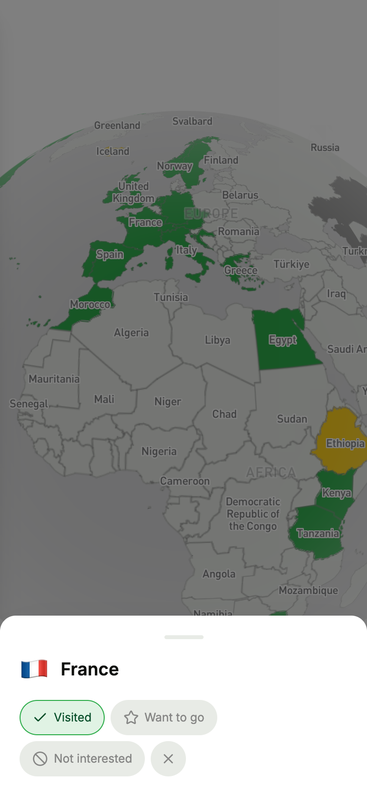

# Traviz

Mark the countries you've visited, want to visit, or aren't interested in, on an interactive globe. Your marks sync to your account, so they follow you across devices.



## Features

- **Interactive globe.** Spin and zoom the Mapbox globe, then click or tap a country to mark it. The globe keeps spinning until you interact with it.
- **Three states per country.** Visited, Want to go, and Not interested. Select the active state again, or use the clear button, to remove a mark.
- **Searchable list.** Every country grouped by continent, with search and filters by state. Territories are labeled.
- **Stats.** Progress toward the 195 countries in the headline count, with totals per state and a breakdown by continent.
- **Passwordless sign-in.** Enter your email and open the magic link. No passwords.
- **Synced to your account.** Every change is saved to a Turso (libSQL) database.
- **Works on phones.** Countries are marked from a bottom sheet, and a tab bar at the bottom holds the navigation.

## Screenshots

<table>
  <tr>
    <td width="50%"></td>
    <td width="50%"></td>
  </tr>
  <tr>
    <td colspan="2" align="center"></td>
  </tr>
</table>

<p align="center">
  
  
  
</p>

Screenshots show a demo account with sample marks, captured from a local production build.

## Getting started

### Quick setup for local development

```bash
bun install
bun run setup
bun run dev
```

`bun run setup` fills in `.env.local` for this worktree and keeps any value already there. It needs the `clerk` CLI logged in and linked to this app through the git remote, and the `vercel` CLI logged in. It does the following:

- Pulls the Clerk development keys with `clerk env pull --instance dev`. It refuses to write a `pk_live_` or `sk_live_` key.
- Pulls only `NEXT_PUBLIC_MAPBOX_TOKEN` from the Vercel development environment. It refuses a token that does not start with `pk.`, because a `NEXT_PUBLIC_` value ships to every browser. Without a token the globe shows a flat placeholder, and the list, stats and sign-in still work.
- Sets `TURSO_DATABASE_URL=file:.data/dev.db` and runs `bun run db:migrate`. Marks live in `.data/dev.db` inside each worktree, so no worktree writes a shared database. Setup refuses to run when `.env.local` or the process environment (shell or `.env`) names a remote database, a database file outside this worktree's `.data/` or a live Clerk key.
- Creates the Clerk development user `agent+clerk_test@example.com` if it does not exist yet.

`.env.example` lists the same variables.

To get a signed-in session without opening an email, run `bun run sign-in-token`. It prints a sign-in token for the development user that lasts 10 minutes. Open `/sign-in`, then run this in the browser console with the token as `ticket`, after `window.Clerk.loaded` is true:

```js
const signIn = await window.Clerk.client.signIn.create({ strategy: "ticket", ticket });
await window.Clerk.setActive({ session: signIn.createdSessionId });
```

The steps below set up the app by hand, for production or for a remote database.

### Prerequisites

- Node.js 20.9 or later (required by Next.js 16)
- Bun 1.4.3, the version CI pins. Bun does not check the `devEngines` version, so another version installs without a warning
- A Mapbox public access token
- A Turso database
- A Clerk application set up for email link sign-in only

### Install

```bash
bun install
```

### Configure environment variables

Create a `.env.local` file in the project root:

```env
NEXT_PUBLIC_MAPBOX_TOKEN=pk.your_mapbox_public_token
NEXT_PUBLIC_CLERK_PUBLISHABLE_KEY=pk_test_your_clerk_publishable_key
CLERK_SECRET_KEY=sk_test_your_clerk_secret_key
TURSO_DATABASE_URL=libsql://your-database.turso.io
TURSO_AUTH_TOKEN=your_turso_auth_token
```

| Variable                            | Purpose                                                                                                            |
| ----------------------------------- | ------------------------------------------------------------------------------------------------------------------ |
| `NEXT_PUBLIC_MAPBOX_TOKEN`          | Public Mapbox token that renders the globe. Restrict it to your domains in the Mapbox dashboard before going live. |
| `NEXT_PUBLIC_CLERK_PUBLISHABLE_KEY` | Public Clerk key used to render sign-in and load the session in the browser.                                       |
| `CLERK_SECRET_KEY`                  | Secret Clerk key used on the server to verify sessions. Never expose it to the client.                             |
| `TURSO_DATABASE_URL`                | libSQL URL of the database that stores marks.                                                                      |
| `TURSO_AUTH_TOKEN`                  | Auth token for that database.                                                                                      |

Both Clerk keys are on the API Keys page of your Clerk dashboard.

The Clerk instance must use email link (magic link) sign-in only: no password or social providers.

### Set up the database

```bash
bun run db:migrate
```

This creates the `marks` table, which holds one row per user and country.

### Run locally

```bash
bun run dev
```

Open http://localhost:3000, enter your email, and open the link in the sign-in email.

## Scripts

| Command                 | What it does                                                                                                                          |
| ----------------------- | ------------------------------------------------------------------------------------------------------------------------------------- |
| `bun run dev`           | Start the Next.js dev server                                                                                                          |
| `bun run build`         | Build for production                                                                                                                  |
| `bun run start`         | Serve the production build                                                                                                            |
| `bun run setup`         | Fill in `.env.local` with development values, migrate `.data/dev.db` and create the development user                                  |
| `bun run sign-in-token` | Print a sign-in token for the development user                                                                                        |
| `bun run perf`          | A/B a production build of HEAD against `--baseline <ref>` (default `main`) in a throttled, signed-in Chrome                           |
| `bun run db:migrate`    | Create the `marks` table                                                                                                              |
| `bun run gen:countries` | Regenerate `src/features/countries/countries.generated.ts` from the `world-countries` package. `--check` fails when it is out of date |
| `bun run lint`          | Lint with Oxlint                                                                                                                      |
| `bun run format`        | Format with Oxfmt                                                                                                                     |
| `bun run typecheck`     | Type-check with `tsc --noEmit`                                                                                                        |
| `bun run check:docs`    | Check that the docs name only paths and scripts that exist                                                                            |
| `bun run test`          | Run the bun tests under `src`                                                                                                         |
| `bun run test:rules`    | Run the lint rule tests in `tools/oxlint` with Node 24                                                                                |
| `bun run check:bundle`  | Check the last build's first-load JS and preloads against `bundle-budget.json`                                                        |
| `bun run check`         | Run CI's checks, except fallow and react-doctor, with a build                                                                         |

`bun run perf` refuses a dirty tree, a `bun.lock` that differs from the baseline, a bun other than the `devEngines` pin, a database outside `.data/`, fewer than 5 runs, and a second run anywhere on the machine (`~/.local/state/traviz/perf.lock`). AGENTS.md describes the method and how to read the report.

## Country data

`src/features/countries/countries.generated.ts` has 250 entries generated from the `world-countries` package. Each entry has a `kind`. The 195 `sovereign` entries count toward the headline total. The 55 `territory` entries appear on the map and in the list, but they aren't counted. Each entry also has the `center` the globe flies to and a `hasGlobeLabel` flag for the label layer. The file is committed, so only run `bun run gen:countries` after you update that dependency. `bun run check` runs `bun run gen:countries --check`, which fails when the committed file differs from a fresh run.

## Project structure

```text
.
├── docs/    Screenshots for this README
├── scripts/ Local setup, sign-in tokens, database migration, country generation, and the docs and bundle checks
└── src/
    ├── app/             Routes: / (globe), /list, /stats, and /sign-in
    ├── features/app-shell/ Globe shell, top bar, nav tabs, and the server-only session layer that loads marks
    ├── features/auth/   Email link sign-in, the account button and section, and the server-only session helpers
    ├── features/countries/ Generated country dataset, search, and the country heading
    ├── features/country-list/ Country list page, with its search, status and continent filters
    ├── features/globe/  Mapbox globe, its overlay, country card and sheet, search, and the selected-country store
    ├── features/marks/  Marks store, mark controls, and the Server Actions and services that save and load marks
    ├── features/stats/  Stats page, progress card, and the totals by continent
    ├── shared/          Class name helper, brand mark, server-only database and env code, and test helpers
    └── proxy.ts         Gates each request by its ROUTES row in paths.ts
```

## Deployment

- The project is deployed on Vercel. Any host that runs Next.js works too.
- Set the same environment variables on your host.
- Add your production domain to the Clerk instance in the Clerk dashboard.

## Contributing

Read [AGENTS.md](AGENTS.md) before contributing. It explains how the app works, lists the project's rules, and names the check that enforces each one.

## License

MIT. See [LICENSE](LICENSE).
